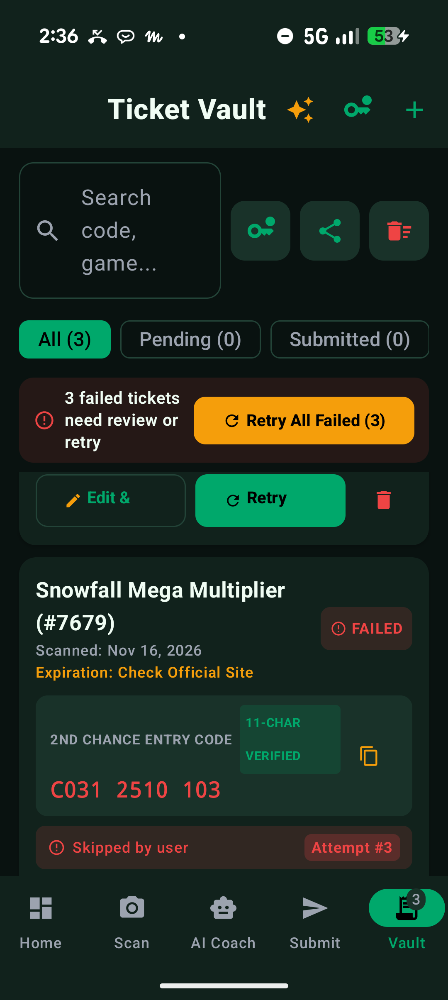

# SecondChance IL

An Android app for Illinois Lottery players who hold on to non-winning instant tickets for the
2nd Chance drawings. Point the camera at a ticket, the app reads the 11-character entry code
off it with on-device OCR, files it under the right game with its promotion deadline, and helps
you enter it on the official Illinois Lottery 2nd Chance portal without typing eleven characters
by hand — forty times in a row.

<p align="center">
  
</p>

---

## What it does

- **Scan** — CameraX viewfinder with a guided alignment box. ML Kit on-device text recognition
  reads the entry code; nothing leaves the phone to do it.
- **Identify the game** — from the ticket title or the printed game number, and when neither
  reads cleanly (script titles like *Treemendous Cash* OCR badly) it falls back to the entry
  code's first letter, which is unique per game within a promotion.
- **Verify before you trust it** — codes are shown in a monospace, grouped field so `0`/`O` and
  `1`/`I` can't hide, with a review flag on anything the parser had to guess or correct.
- **File it** — every ticket goes into a Room database with its game, game number, scan date,
  promotion deadline and submission status.
- **Enter it** — the Submit screen opens the official 2nd Chance entry page in an in-app WebView,
  selects the right game, fills the entry code, and reads the portal's own answer back
  (accepted / duplicate / rejected / locked out) so the vault stays accurate.
- **Track it** — the Vault lists everything scanned, with filters for pending, submitted and
  duplicate, delete on any ticket, and "Back to queue" on tickets that have left pending. A
  ticket the portal rejects stays pending rather than moving to a state of its own, and
  Auto-Fill asks before retrying that code for as long as the Submit screen stays open —
  leaving the screen clears that list.

## Scope and conduct

This is a personal utility, not a Lottery product.

- Not affiliated with, endorsed by, or connected to the Illinois Lottery or its operators.
- The app fills the official entry form; it does not bypass authentication, rate limits or any
  portal control. The portal's attempt lockout is detected and respected — the app stops rather
  than retrying through it.
- Illinois Lottery rules require you to keep the physical ticket. The app stores a photo for
  reference only; it is not a substitute for the ticket itself.

## Screens

| Screen | What it's for |
|---|---|
| **Dashboard** | Counts of scanned / pending / submitted, and countdowns to each promotion's final entry date |
| **Scan** | Camera viewfinder, OCR, and a review sheet for correcting the code and game before saving |
| **Submit** | In-app WebView on the official portal, with auto-fill of game and entry code and result read-back |
| **Vault** | Searchable ticket ledger with status filters, delete, and requeue for tickets that have left pending |

## Architecture

```
┌─────────────────────────────────────────────────────────────────────┐
│                    Jetpack Compose UI (Material 3)                  │
│   DashboardScreen   CameraScannerScreen   BatchSubmissionScreen     │
│                      TicketVaultScreen                              │
└───────────────┬─────────────────────────────────────────────────────┘
                │ StateFlow
┌───────────────▼─────────────────────────────────────────────────────┐
│                           MainViewModel                             │
│        UI state  ·  scan state  ·  submission orchestration         │
└──────┬──────────────────────────────────┬───────────────────────────┘
       │                                  │
┌──────▼───────────────────┐   ┌──────────▼──────────────────────────┐
│       Repositories       │   │        Submission bridge            │
│  TicketRepository        │   │  SubmissionAutomationHelper         │
│  UserPreferencesRepo     │   │   · JS generators for the form      │
└──────┬───────────────────┘   │   · PortalResult parsing from       │
       │                       │     the page's own #entry-alert     │
┌──────▼───────────────────┐   └─────────────────────────────────────┘
│       Persistence        │
│  Room (tickets)          │   ┌─────────────────────────────────────┐
│  DataStore (settings)    │   │             Scanner                 │
│  Internal storage (pics) │   │  CameraX  →  ML Kit text recognition│
└──────────────────────────┘   │  →  LotteryCodeParser (rule-based)  │
                               └─────────────────────────────────────┘
```

**Why a WebView instead of an HTTP client.** The portal is a React app behind a session, CSRF
tokens and anti-bot measures. A real browser session the user has logged into themselves is both
the honest way to do this and the only one that doesn't break every time the site ships.

**Why on-device OCR.** No per-scan cost, no network round trip, no ticket images leaving the
phone.

**Why rule-based parsing on top of OCR.** Illinois entry codes have a known shape — a game
letter plus ten digits — so the parser can reject impossible reads, repair the handful of
character confusions OCR actually makes, and flag the rest for human review instead of silently
submitting garbage into a five-strikes-and-you're-out form.

## Tech stack

Kotlin · Jetpack Compose · Material 3 · CameraX · ML Kit Text Recognition · Room · DataStore ·
Coroutines/Flow · WebView · Coil · Gradle 9 with version catalogs · JUnit + Robolectric

## Project layout

```
app/src/main/java/com/jtownzen/secondchanceil/
├── MainActivity.kt              Compose host, bottom navigation
├── data/
│   ├── AppDatabase.kt           Room database
│   ├── LotteryTicket.kt         Ticket entity
│   ├── TicketDao.kt             Queries, reactive Flows
│   ├── TicketRepository.kt
│   ├── LotteryGame.kt           Active games, codes, promotion deadlines
│   └── UserPreferencesRepository.kt
├── scanner/
│   ├── CameraScannerScreen.kt   Viewfinder, capture, review sheet
│   └── LotteryCodeParser.kt     OCR text → game + entry code
├── submission/
│   ├── BatchSubmissionScreen.kt In-app browser and submission queue
│   └── SubmissionAutomationHelper.kt  JS generation, portal result parsing
└── ui/                          Dashboard, Vault, dialogs, theme

docs/second-chance-games.md      Live game list, code letters, deadlines
```

## Building

Prerequisites: Android Studio Panda 2 (2025.3.2) or newer, JDK 17, Android SDK Platform 36.1.

```
git clone https://github.com/jtownzen-42/SecondChanceLotto.git
```

`debug.keystore` is gitignored, so a fresh clone does not have one and the `debugConfig`
signing config fails. Generate one in the repository root, with the same parameters CI uses:

```
keytool -genkeypair -v -keystore debug.keystore -storepass android -alias androiddebugkey -keypass android -keyalg RSA -keysize 2048 -validity 10000 -dname "CN=Android Debug,O=Android,C=US"
```

Open the folder in Android Studio and run the `app` configuration on a device or emulator.
A camera is needed for scanning; manual entry works without one.

There is no Gradle wrapper checked in — Android Studio supplies Gradle, and CI pins 9.3.1. To
build from a terminal instead, install Gradle 9.3.1 and run `gradle assembleDebug`.

Copy `.env.example` to `.env` if you are building the Firebase-backed variants.

## Keeping the game list current

`docs/second-chance-games.md` is the source of truth for which games are in the portal's
*Select game* list and which letter each game's entry codes start with. When a promotion ends or
a new one starts, update that table and `activeGames` in
`app/src/main/java/com/jtownzen/secondchanceil/data/LotteryGame.kt` together.

Letters marked **confirmed** were read off real tickets; **inferred** ones follow the pattern the
confirmed ones show and should be corrected the first time a ticket of that game is scanned.

## Tests

```
gradle test
```

Unit and Robolectric coverage for the parser (`ScannerAccuracyTest`), game matching
(`GameSelectionTest`), portal result handling (`SubmissionLogicTest`) and the repository layer.

## License

Personal project. All Illinois Lottery names, game titles and marks belong to the Illinois
Lottery.
